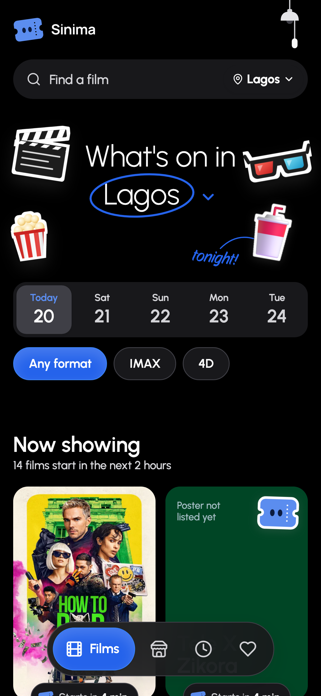
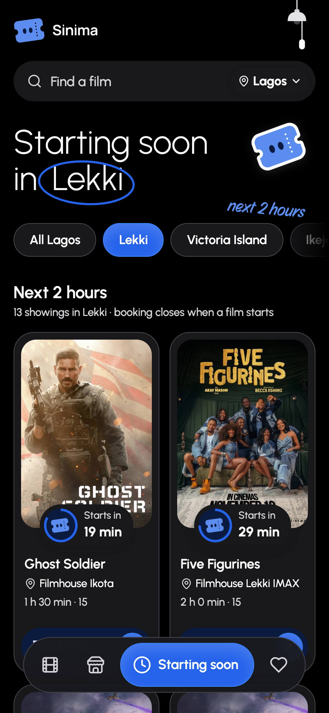
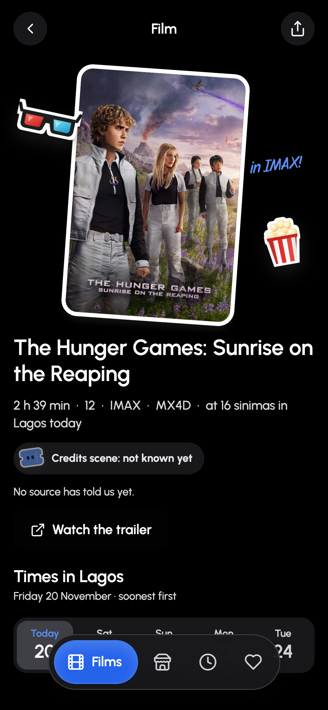
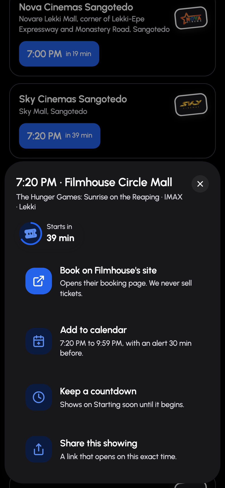
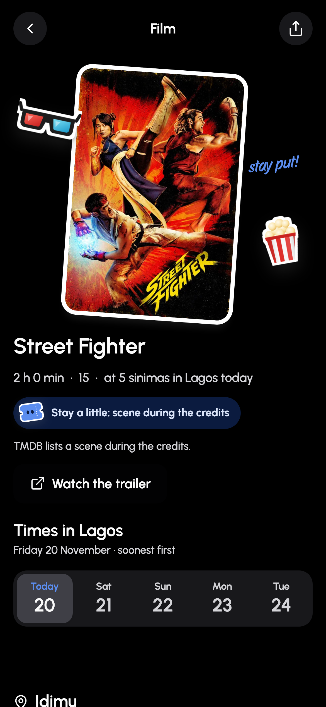
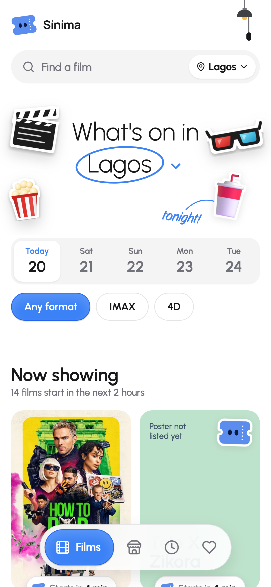

<p align="center">
  
</p>

<h1 align="center">Sinima</h1>

<p align="center">
  Every cinema's showtimes in <strong>Lagos</strong> and <strong>Abuja</strong>, in one fast page.<br/>
  What's starting soon near you — and should you stay for the credits?
</p>

<p align="center">
  <a href="https://sinima.vercel.app">sinima.vercel.app</a>&nbsp;&nbsp;·&nbsp;&nbsp;
  <a href="docs/PRD.md">PRD</a>&nbsp;&nbsp;·&nbsp;&nbsp;
  <a href="docs/SPEC.md">Spec</a>&nbsp;&nbsp;·&nbsp;&nbsp;
  <a href="docs/DECISIONS.md">Decisions</a>
</p>

<br/>

<p align="center">
  &nbsp;&nbsp;
  &nbsp;&nbsp;
  &nbsp;&nbsp;
  
</p>

<p align="center">
  &nbsp;&nbsp;
  
</p>

---

## ✨ What it does

Lagos and Abuja are Nigeria's cinema capitals, but showtimes are scattered across chain websites, booking engines, and Instagram pages. Sinima puts them all in one place.

- **🎬 Films** — Everything showing today, tomorrow, and the next five days, with poster art, format badges (IMAX, 4D), and runtime
- **⏱️ Starting soon** — Showings in the next 2 hours, filtered by area (Lekki, Ikeja, Victoria Island…)
- **🍿 Stay or Go** — Should you sit through the credits? Each film shows whether there's a mid- or post-credits scene, sourced from TMDB
- **🎟️ Book** — One tap opens the cinema's own booking page. Sinima never sells tickets
- **📅 Remind me** — Add any showing to your calendar with a 30-minute alert
- **🔗 Share** — Send a specific showing to a WhatsApp group with one tap
- **🔍 Search** — Find any film by name, instantly
- **🌙 Dark & light mode** — Respects your preference, or toggle with one tap
- **📱 Installable** — Add to Home Screen for an app-like experience with offline support

## 🏗️ How it's built

| Layer | Stack |
| --- | --- |
| **Framework** | [Next.js 16](https://nextjs.org/) with static export (`output: "export"`) |
| **Language** | TypeScript 5.9 |
| **Styling** | [Tailwind CSS 4](https://tailwindcss.com/) |
| **UI** | React 19, custom components (sheets, segmented controls, spring animations) |
| **Data pipeline** | Node.js scripts that fetch and parse each cinema's page at build time |
| **Film metadata** | [TMDB API](https://www.themoviedb.org/) — posters, runtime, credits scenes |
| **Hosting** | [Vercel](https://vercel.com/) (static + edge rewrites for poster proxy) |
| **Testing** | [Vitest](https://vitest.dev/) (unit) + [Playwright](https://playwright.dev/) (E2E) |
| **CI** | GitHub Actions |

The entire site is statically generated at build time — no server, no database, no API calls from the browser. Poster images are proxied through Vercel edge rewrites to avoid exposing TMDB tokens.

## 📊 How the data works

Showtimes come from cinemas' own pages or from listings that gave permission. Each source is listed with its real status in [`data/sources.json`](data/sources.json).

| Principle | Detail |
| --- | --- |
| **Transparency** | Every showtime says where it came from and when it was last read, in plain words |
| **Freshness** | Stale data (>24 h old) is flagged with a warning — never silently shown |
| **No guessing** | Unknown fields are `null`, never fabricated. No prices unless the source provides them |
| **Respect** | Robots.txt is checked. Fetches are polite (5 s gap, user-agent with contact URL). No scraping of sites that say no |
| **No monetisation** | No ads, no ticket sales, no commission. Booking always happens on the cinema's own site |

Film metadata and credits-scene tags come from [TMDB](https://www.themoviedb.org/). This product uses the TMDB API but is not endorsed or certified by TMDB.

**Want something changed or removed?** [Open an issue](https://github.com/ChimeXXD/sinima/issues) or use the contact on the About page.

## 🚀 Run locally

Requires **Node ≥ 22**.

```bash
git clone https://github.com/ChimeXXD/sinima.git
cd sinima
npm ci
cp .env.example .env.local   # add a TMDB key (free at themoviedb.org)
npm run dev
```

### Scripts

| Command | What it does |
| --- | --- |
| `npm run dev` | Start the dev server |
| `npm run build` | Static build to `out/` |
| `npm run refresh` | Fetch fresh showtimes from all cleared sources |
| `npm test` | Run unit tests (Vitest) |
| `npm run test:e2e` | Run end-to-end tests (Playwright) |
| `npm run lint` | ESLint + token check |
| `npm run typecheck` | TypeScript type check |
| `npm run budget` | Check page weight budgets |

## 📂 Project structure

```
sinima/
├── src/
│   ├── app/              # Next.js App Router pages
│   │   ├── [city]/       # City-scoped routes (Lagos, Abuja)
│   │   ├── film/[slug]/  # Film detail page
│   │   ├── cinema/[id]/  # Cinema detail page
│   │   ├── area/[slug]/  # Area cinemas page
│   │   ├── soon/         # Starting soon
│   │   ├── cinemas/      # All cinemas
│   │   ├── yours/        # Your saved cinemas
│   │   ├── about/        # About, sources, TMDB notice
│   │   └── cal/          # .ics calendar file routes
│   ├── components/       # React components (ui/, about/, where/, …)
│   ├── lib/              # Core logic (data loading, time, sharing, theme)
│   └── styles/           # Global CSS, tokens, theme switch
├── data/                 # Cinema registry, sources, film data
├── scripts/              # Data pipeline (fetch → parse → merge → write)
├── docs/                 # PRD, spec, decisions, design, research
├── public/               # Icons, fonts, logos, stickers, manifest
└── tests/                # Fixtures and E2E test specs
```

## 🎨 Design

Sinima's UI is designed mobile-first for data-conscious users. Key design choices:

- **Page weight budget** — Every page is measured against a byte budget to stay fast on 3G
- **CSS chunking** — Turbopack graph-based CSS chunking so each page loads only its own styles
- **Spring animations** — Physics-based motion that respects `prefers-reduced-motion`
- **Stickers** — Playful cinema stickers (popcorn 🍿, clapperboard 🎬, 3D glasses) add personality
- **Accessibility** — Semantic HTML, 44 px tap targets, visible focus, works at 200% zoom and 320 px wide

## 🌍 Background

"Sinima" is how "cinema" is said and spelt in Yoruba and Hausa.

Nigeria's box office hit ₦15.6 billion in 2025, up 35% year-on-year, with Nollywood taking the lead over Hollywood for the first time. Lagos alone has 51 licensed cinemas across seven chains. But showtimes are scattered — each chain has its own site, its own booking engine, its own layout. The evening question *"What can I catch in the next two hours, near me?"* has no single answer.

Sinima is that answer: one screen, every cinema, every time — with where it came from and whether to stay for the credits.

## 👤 Author

A portfolio build by **[Chime Ekpendu](https://chimexd.work)**.

## 📄 Licence

[MIT](LICENSE). Showtimes belong to the cinemas; film data belongs to TMDB and its contributors.
